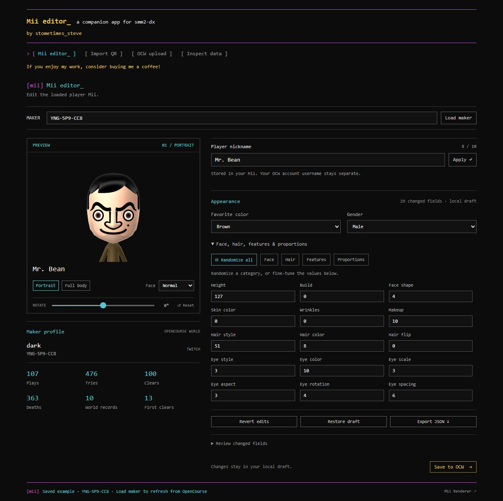

# Mii editor_

A companion app for [smm2-dx](https://github.com/sometimes-steve/smm2-dx).

Edit your player Mii, import character QR codes, and upload directly to OpenCourse World.



## Features

- Load an OCW maker code or maker API URL.
- Preview your Mii in portrait or full-body view, with expressions and rotation.
- Edit the player nickname, favorite color, gender, face, hair, facial features, and proportions.
- Randomize the whole appearance or individual categories.
- Import standard 3DS/Wii U Mii QR codes from an image or MiiCharacters link.
- Keep local drafts, review changed fields, and export JSON or an 88-byte `.charinfo` file.
- Upload to OCW using your own `ocw-config.json`, then verify the saved bytes through the public API.

## Getting started

Install [Node.js](https://nodejs.org/) 22 or newer, then run:

```sh
git clone https://github.com/sometimes-steve/mii-editor.git
cd mii-editor
npm install
npm start
```

Open [localhost:3210](http://localhost:3210). The bundled example loads immediately; enter your maker code and click **Load maker** to fetch your current profile.

The editor runs independently on your computer. Editing, QR import, and direct OCW upload require no game checkout.

## Upload to OpenCourse World

Direct upload also requires Python 3.12 or newer. Set up the optional upload client:

```sh
npm run setup:ocw
```

Restart `npm start` after setup.

1. Load your maker in the editor and make your changes.
2. Open **OCW upload**.
3. Choose your own `ocw-config.json`, enter the maker code belonging to that config, and click **Use this config**.
4. Click **Upload directly to OCW**.

The app backs up the previous public profile in `backups/` before submitting. It reports a verified upload only when a separate public API request returns the exact 88 submitted Mii bytes. If submission is acknowledged but readback differs, check persistence before retrying.

The player nickname is part of the Mii; the OCW account username and existing clothing values are preserved. The config must belong to the account you are updating. Config selection validates the file format; authentication occurs when uploading. Only `server.opencourse.world` is supported.

Credentials are held in the local server's memory and passed to the Python client through stdin. They are not saved to browser storage, copied to disk, included in backups, or returned by the server. **Forget config** or restarting the server clears the selection. Never commit or share your config file.

## Import character QR codes

Open **Import QR**, then paste, drop, or choose a PNG/JPEG image. You can also enter a [MiiCharacters](https://www.miicharacters.com/browse) character-page or QR-image link. Enable the nickname option if you also want the character's name.

Imports preserve the loaded Switch Mii's identity and maker metadata. They update the local draft; uploading remains a separate action.

Standard encrypted 3DS/Wii U Mii QR codes are supported. Images are limited to 8 MB and 4 megapixels. Switch 2, game-specific QR formats, and QR codes containing only website links are not supported.

## Drafts and exports

Drafts are stored in your browser and scoped to the maker. They restore automatically when the loaded baseline still matches. Use JSON or `.charinfo` export for a portable copy. Rotation and expressions affect the preview only.

To restore a profile backup, open **Inspect data**, import the backup's `before` maker object through the source/import controls, then upload and verify it.

## Optional local file export

**Save to a local folder** writes an 88-byte `mii.charinfo` file to a folder you explicitly configure with `OCW_GAME_DATA_ROOT` before starting the editor. There is no default destination. Existing custom files are backed up before replacement.

This is an optional file export for software that supports this format. The editor does not detect or modify an installed game, include a runtime patch, or guarantee that another application will load the file. Exporting does not upload anything to OCW; use direct upload for that.

## Configuration

| Variable | Purpose |
| --- | --- |
| `PORT` | Local HTTP port; defaults to `3210`. |
| `OCW_SETUP_PYTHON` | Python executable used to create the optional `.venv`. |
| `OCW_PYTHON` | Override the configured upload-client Python executable. |
| `OCW_GAME_DATA_ROOT` | Explicit destination folder for optional `mii.charinfo` export; unset by default. |

## Data and services

The editor works with Nintendo Switch `nn::mii::CharInfo` data (88 bytes). Decoding and editing happen locally. Previews send the Mii bytes and view settings to [Arian's Mii Renderer](https://mii-unsecure.ariankordi.net/), which must be online. Maker requests and uploads go to OCW; importing a MiiCharacters link fetches that site's image. The local server proxies these requests and listens only on loopback.

Direct upload uses the authenticated NEX `SyncUserProfile` protocol through [NintendoClients](https://github.com/kinnay/NintendoClients). Public API readback is used to verify persistence independently of the protocol acknowledgement.

## Development

```sh
npm test
```

The tests cover CharInfo decoding and editing, randomization, QR authentication and conversion, config handling, game-file backups, and upload/readback verification. They do not perform a live OCW upload.

References and dependencies: [MiiToStudio](https://github.com/ariankordi/mii-fusion-experiments/blob/main/MiiToStudio/MiiToStudio.fu), [Pretendo mii-js](https://github.com/PretendoNetwork/mii-js), [jsQR](https://github.com/cozmo/jsQR), [MiiImportController](https://gist.github.com/ariankordi/a8e24dcc17fd4fd78c32771725f0efe4).

## Support

If you enjoy my work, consider buying me a coffee! [https://buymeacoffee.com/sometimes_steve](https://buymeacoffee.com/sometimes_steve)
